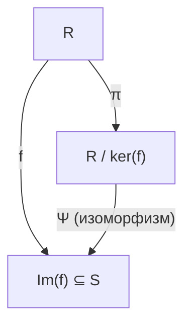

# Лекция: Факторкольца, теоремы об изоморфизме и Китайская теорема об остатках

### Содержание
- Гомоморфизмы колец и прямое произведение
- Построение факторкольца по идеалу
- Первая теорема о гомоморфизме колец
- Китайская теорема об остатках (КТО) для идеалов
  - Формулировка и доказательство
  - Равенство произведения и пересечения взаимно простых идеалов
  - Примеры применения КТО ($\mathbb{Z}$ и кольца многочленов)
- Факторизация в областях целостности и областях главных идеалов (ОГИ)
  - Связь простоты элемента со свойствами факторкольца
  - Построение полей расширения ($\mathbb{Q}[\sqrt[3]{2}]$)

---

## 1. Напоминание: гомоморфизмы и прямое произведение колец

> **Определение**: Пусть $R$ и $S$ — ассоциативные кольца с единицей. Отображение $f: R \to S$ называется **гомоморфизмом колец**, если для любых $x, y \in R$ выполнены условия:
> 1. $f(x + y) = f(x) + f(y)$;
> 2. $f(xy) = f(x) \cdot f(y)$;
> 3. $f(1_R) = 1_S$.

> **Замечание (Прямое произведение колец)**: Пусть $R$ и $S$ — кольца. Их прямое декартово произведение $R \times S$ является кольцом относительно покомпонентных операций:
> $$
> (r_1, s_1) + (r_2, s_2) \coloneqq (r_1 + r_2,\, s_1 + s_2),
> $$
> $$
> (r_1, s_1) \cdot (r_2, s_2) \coloneqq (r_1 r_2,\, s_1 s_2).
> $$
> При этом канонические проекции на сомножители:
> $$
> \pi_1: R \times S \to R, \quad (r, s) \mapsto r,
> $$
> $$
> \pi_2: R \times S \to S, \quad (r, s) \mapsto s
> $$
> являются сюръективными гомоморфизмами колец.

---

## 2. Факторкольцо по идеалу

Пусть $R$ — коммутативное кольцо с единицей, $I \trianglelefteq R$ — его идеал.

Введем на $R$ отношение эквивалентности по модулю идеала $I$:
$$
a \sim_I b \iff a - b \in I.
$$
Данное отношение традиционно обозначается как $a \equiv b \pmod I$.

> **Определение**: Множество классов эквивалентности обозначается $R / I \coloneqq R / {\sim_I}$. Класс элемента $a \in R$ обозначается как $[a]$ или $a + I$:
> $$
> a + I = \{a + i \mid i \in I\}.
> $$
> В частности, классом нуля является сам идеал: $[0] = 0 + I = I$.

Зададим на множестве $R / I$ операции сложения и умножения:
$$
(a + I) + (b + I) \coloneqq (a + b) + I,
$$
$$
(a + I) \cdot (b + I) \coloneqq (ab) + I.
$$

### Корректность введенных операций

Покажем, что результат операций не зависит от выбора представителей смежных классов. Пусть $\tilde{a} \in a + I$ и $\tilde{b} \in b + I$, то есть:
$$
\tilde{a} = a + i_1, \quad \tilde{b} = b + i_2, \quad \text{где } i_1, i_2 \in I.
$$

1. **Сложение**:
   $$
   \tilde{a} + \tilde{b} = (a + i_1) + (b + i_2) = (a + b) + \underbrace{(i_1 + i_2)}_{\in I}.
   $$
   Следовательно, $(\tilde{a} + \tilde{b}) + I = (a + b) + I$.

2. **Умножение**:
   $$
   \tilde{a}\tilde{b} = (a + i_1)(b + i_2) = ab + \underbrace{a i_2 + i_1 b + i_1 i_2}_{\in I},
   $$
   поскольку $I$ — идеал (замкнут относительно умножения на элементы кольца $R$ и замкнут по сложению).
   Следовательно, $\tilde{a}\tilde{b} + I = ab + I$.

Таким образом, $(R / I, +, \cdot)$ — корректно определенное кольцо, называемое **факторкольцом** кольца $R$ по идеалу $I$.

> **Следствие**: Отображение канонической проекции:
> $$
> \pi: R \to R / I, \quad a \mapsto a + I
> $$
> является сюръективным гомоморфизмом колец, причем $\ker \pi = I$.

**Пример:** При $R = \mathbb{Z}$ и $I = n\mathbb{Z}$ факторкольцо $\mathbb{Z} / n\mathbb{Z}$ совпадает с кольцом вычетов по модулю $n$.

---

## 3. Первая теорема о гомоморфизме колец

> **Определение**: **Ядром** гомоморфизма колец $f: R \to S$ называется множество:
> $$
> \ker(f) \coloneqq \{x \in R \mid f(x) = 0_S\}.
> $$

> **Лемма**: Для любого гомоморфизма колец $f: R \to S$ ядро $\ker(f)$ является идеалом в $R$ ($\ker(f) \trianglelefteq R$).
>
> **Доказательство:**
> 1. Если $a, b \in \ker(f)$, то $f(a + b) = f(a) + f(b) = 0 + 0 = 0 \implies a + b \in \ker(f)$.
> 2. Если $a \in \ker(f)$ и $r \in R$, то $f(ra) = f(r)f(a) = f(r) \cdot 0 = 0 \implies ra \in \ker(f)$.
> 
> Следовательно, $\ker(f)$ — идеал в $R$. $\blacksquare$

> **Теорема (Первая теорема о гомоморфизме колец)**: Пусть $f: R \to S$ — гомоморфизм колец. Тогда существует единственный изоморфизм колец:
> $$
> \Psi: R / \ker(f) \xrightarrow{\sim} \operatorname{Im}(f),
> $$
> действующий по правилу $\Psi([a]) = f(a)$ для любого $a \in R$.

**Доказательство:**

1. **Корректность отображения $\Psi$**:
   Пусть $[a] = [\tilde{a}]$, то есть $\tilde{a} \in a + \ker(f)$, значит $\tilde{a} = a + k$, где $k \in \ker(f)$. Тогда:
   $$
   f(\tilde{a}) = f(a + k) = f(a) + f(k) = f(a) + 0 = f(a).
   $$
   Значение $\Psi([a]) = f(a)$ не зависит от выбора представителя.

2. **Гомоморфность $\Psi$**:
   - $\Psi([a] + [b]) = \Psi([a + b]) = f(a + b) = f(a) + f(b) = \Psi([a]) + \Psi([b])$;
   - $\Psi([a] \cdot [b]) = \Psi([ab]) = f(ab) = f(a)f(b) = \Psi([a]) \cdot \Psi([b])$;
   - $\Psi([1_R]) = f(1_R) = 1_S$.

3. **Сюръективность**:
   По определению образа $\operatorname{Im}(f)$, для любого $y \in \operatorname{Im}(f)$ найдется $a \in R$ такой, что $f(a) = y$. Тогда $\Psi([a]) = f(a) = y$.

4. **Инъективность**:
   Найдем ядро гомоморфизма $\Psi$:
   $$
   [a] \in \ker \Psi \iff \Psi([a]) = 0_S \iff f(a) = 0_S \iff a \in \ker(f) \iff [a] = [0] \in R / \ker(f).
   $$
   Так как ядро тривиально ($\ker \Psi = \{[0]\}$), отображение $\Psi$ инъективно.

Таким образом, $\Psi$ — биективный гомоморфизм, то есть изоморфизм колец: $R / \ker(f) \cong \operatorname{Im}(f)$. $\blacksquare$

---

## 4. Китайская теорема об остатках для идеалов

> **Определение**: Идеалы $I, J \trianglelefteq R$ называются **взаимно простыми** (или *комаксимальными*), если:
> $$
> I + J = R = (1).
> $$

> **Теорема (КТО для идеалов)**: Пусть $R$ — коммутативное кольцо с единицей, и $I_1, I_2, \dots, I_n \trianglelefteq R$ — попарно взаимно простые идеалы, то есть:
> $$
> I_i + I_j = R \quad \forall \, i \neq j.
> $$
> Тогда существует изоморфизм колец:
> $$
> \Phi: R / \left(\prod_{i=1}^n I_i\right) \xrightarrow{\sim} \prod_{i=1}^n (R / I_i).
> $$
> При этом выполняется равенство $\prod_{i=1}^n I_i = \bigcap_{i=1}^n I_i$.

### Доказательство

#### Шаг 1: Конструкция сюръективного гомоморфизма

Рассмотрим отображение:
$$
\hat{\Phi}: R \longrightarrow \prod_{i=1}^n (R / I_i), \quad r \longmapsto (r + I_1,\, r + I_2,\, \dots,\, r + I_n).
$$
Отображение $\hat{\Phi}$ является гомоморфизмом колец, так как сложение и умножение в прямом произведении покоординатны, а канонические проекции $r \mapsto r + I_i$ являются гомоморфизмами.

Ядро гомоморфизма $\hat{\Phi}$:
$$
\ker(\hat{\Phi}) = \{r \in R \mid r + I_i = 0 + I_i \; \forall i\} = \{r \in R \mid r \in I_i \; \forall i\} = \bigcap_{i=1}^n I_i.
$$

#### Шаг 2: Сюръективность $\hat{\Phi}$

Требуется доказать, что для любого набора элементов $(a_1, \dots, a_n) \in R^n$ разрешима система сравнений:
$$
\begin{cases}
x \equiv a_1 \pmod{I_1}, \\
x \equiv a_2 \pmod{I_2}, \\
\quad \vdots \\
x \equiv a_n \pmod{I_n}.
\end{cases}
$$

Так как $I_i + I_j = R$ при $i \neq j$, для каждой пары индексов найдутся элементы:
$$
u_{ij} \in I_i, \quad v_{ij} \in I_j \quad \text{такие, что} \quad u_{ij} + v_{ij} = 1.
$$
Зафиксируем индекс $i \in \{1, \dots, n\}$ и положим:
$$
e_i \coloneqq \prod_{j \neq i} v_{ij}.
$$

Исследуем свойства элемента $e_i$:
1. При $k \neq i$ сомножитель $v_{ik} \in I_k$ входит в произведение, следовательно:
   $$
   e_i \in I_k \implies e_i \equiv 0 \pmod{I_k}.
   $$
2. По модулю $I_i$: так как $v_{ij} = 1 - u_{ij} \equiv 1 \pmod{I_i}$ (поскольку $u_{ij} \in I_i$), получаем:
   $$
   e_i = \prod_{j \neq i} v_{ij} \equiv \prod_{j \neq i} 1 \equiv 1 \pmod{I_i}.
   $$

Сконструируем элемент:
$$
x = \sum_{i=1}^n a_i e_i.
$$
Проверим вычет элемента $x$ по модулю произвольного идеала $I_k$:
$$
x = a_k e_k + \sum_{i \neq k} a_i e_i \equiv a_k \cdot 1 + \sum_{i \neq k} a_i \cdot 0 \equiv a_k \pmod{I_k}.
$$
Таким образом, $\hat{\Phi}(x) = (a_1 + I_1, \dots, a_n + I_n)$, то есть $\hat{\Phi}$ сюръективен.

По Первой теореме о гомоморфизме:
$$
R / \ker(\hat{\Phi}) = R / \left(\bigcap_{i=1}^n I_i\right) \cong \prod_{i=1}^n (R / I_i).
$$

#### Шаг 3: Совпадение произведения и пересечения идеалов

Покажем по индукции, что в предположении $I_i + I_j = R$ ($\forall i \neq j$) верно:
$$
\prod_{i=1}^n I_i = \bigcap_{i=1}^n I_i.
$$

**База индукции ($n = 2$):**
Пусть $I + J = R$.
- Включение $IJ \subseteq I \cap J$ верно для любых идеалов по определению: если $\sum x_k y_k \in IJ$, где $x_k \in I, y_k \in J$, то ввиду свойств идеала каждый член принадлежит как $I$, так и $J$.
- Обратное включение: так как $I + J = (1)$, существуют $i \in I$ и $j \in J$ такие, что $i + j = 1$. Для любого $y \in I \cap J$:
  $$
  y = y \cdot 1 = y(i + j) = \underbrace{yi}_{\in JI = IJ} + \underbrace{yj}_{\in IJ} \in IJ.
  $$
  Следовательно, $I \cap J \subseteq IJ \implies IJ = I \cap J$.

**Индукционный переход:**
Пусть утверждение доказано для $n - 1$ идеалов: $\prod_{i=1}^{n-1} I_i = \bigcap_{i=1}^{n-1} I_i$.
Рассмотрим:
$$
\prod_{i=1}^n I_i = \left(\prod_{i=1}^{n-1} I_i\right) \cdot I_n.
$$
Покажем, что идеал $\prod_{i=1}^{n-1} I_i$ взаимно прост с $I_n$.
По условию, для каждого $i \in \{1, \dots, n-1\}$ выполнено $I_i + I_n = (1)$, то есть существуют $a_i \in I_i$ и $b_i \in I_n$ такие, что $a_i + b_i = 1$.
Перемножим данные $n - 1$ равенств:
$$
\prod_{i=1}^{n-1} (a_i + b_i) = 1.
$$
Раскрывая скобки в левой части, получаем:
$$
\underbrace{\prod_{i=1}^{n-1} a_i}_{\in \prod_{i=1}^{n-1} I_i} + \underbrace{\beta}_{\in I_n} = 1,
$$
так как каждое слагаемое, отличное от $\prod a_i$, содержит хотя бы один сомножитель $b_k \in I_n$.
Следовательно:
$$
\left(\prod_{i=1}^{n-1} I_i\right) + I_n = R = (1).
$$
Применяя базу индукции для двух идеалов $\left(\prod_{i=1}^{n-1} I_i\right)$ и $I_n$:
$$
\prod_{i=1}^n I_i = \left(\prod_{i=1}^{n-1} I_i\right) \cdot I_n = \left(\prod_{i=1}^{n-1} I_i\right) \cap I_n = \left(\bigcap_{i=1}^{n-1} I_i\right) \cap I_n = \bigcap_{i=1}^n I_i.
$$
Переход доказан. Теорема полностью доказана. $\blacksquare$

---

## 5. Примеры применения КТО

**Пример 1 (Классическая КТО в $\mathbb{Z}$):**
Пусть $m_1, \dots, m_n \in \mathbb{Z}$ — попарно взаимно простые числа, то есть $\gcd(m_i, m_j) = 1$ при $i \neq j$.
В кольце $R = \mathbb{Z}$ рассмотрим идеалы $I_i = (m_i) = m_i \mathbb{Z}$.
Так как $\gcd(m_i, m_j) = 1$, найдутся коэффициенты Безу: $u m_i + v m_j = 1 \implies (m_i) + (m_j) = \mathbb{Z}$.
Следовательно, по КТО:
$$
\mathbb{Z} / (m_1 \cdots m_n)\mathbb{Z} \cong \mathbb{Z} / m_1\mathbb{Z} \times \dots \times \mathbb{Z} / m_n\mathbb{Z}.
$$

**Пример 2 (Факторизация в кольце многочленов):**
Пусть $K$ — поле с $\operatorname{char} K \neq 2$. Рассмотрим кольцо многочленов $K[x]$ и многочлен $x^2 - 1 = (x - 1)(x + 1)$.
Идеалы $I_1 = (x - 1)$ и $I_2 = (x + 1)$ взаимно просты, поскольку:
$$
\frac{1}{2}(x + 1) - \frac{1}{2}(x - 1) = 1 \implies (x - 1) + (x + 1) = K[x].
$$
По КТО:
$$
K[x] / (x^2 - 1) = K[x] / \big((x - 1)(x + 1)\big) \cong K[x] / (x - 1) \times K[x] / (x + 1).
$$

Для каждого множителя рассмотрим гомоморфизм вычисления (evaluation homomorphism):
$$
\operatorname{ev}_c: K[x] \to K, \quad f(x) \mapsto f(c).
$$
Отображение $\operatorname{ev}_c$ сюръективно, а его ядро состоит из всех многочленов, делящихся на $x - c$:
$$
\ker(\operatorname{ev}_c) = (x - c).
$$
По Первой теореме о гомоморфизме:
$$
K[x] / (x - c) \cong K.
$$
Подставляя $c = 1$ и $c = -1$:
$$
K[x] / (x^2 - 1) \cong K \times K.
$$

---

## 6. Факторкольца в областях целостности и ОГИ

Пусть $R$ — коммутативное кольцо с единицей.

> **Лемма 1**: Пусть $R$ — область целостности, $p \in R \setminus \{0\}$.
> $$
> p \text{ — простой элемент} \iff R / (p) \text{ — область целостности.}
> $$
>
> **Доказательство:**
> По определению области целостности:
> $$
> \begin{aligned}
> R / (p) \text{ — область целостности} &\iff \forall [a], [b] \in R / (p) \setminus \{[0]\}: \; [a][b] \neq [0] \\
> &\iff \forall a, b \in R: \; (p \nmid a \land p \nmid b) \implies p \nmid ab \\
> &\iff \forall a, b \in R: \; p \mid ab \implies (p \mid a \lor p \mid b),
> \end{aligned}
> $$
> что в точности совпадает с определением простого элемента $p$. $\blacksquare$

> ⚠️ **Замечание**: В общей коммутативной алгебре этот результат обобщается до базового соотношения: идеал $P \trianglelefteq R$ является простым тогда и только тогда, когда $R / P$ — область целостности.

> **Лемма 2**: Пусть $R$ — область главных идеалов (ОГИ), $p \in R \setminus \{0\}$.
> $$
> p \text{ — простой (неприводимый) элемент} \iff R / (p) \text{ — поле.}
> $$
>
> **Доказательство:**
> - $(\Leftarrow)$: Поле всегда является областью целостности. Если $R / (p)$ — поле, то $R / (p)$ — область целостности, откуда по Лемме 1 элемент $p$ прост.
> - $(\Rightarrow)$: Пусть $p$ — простой элемент. Проверим, что любой ненулевой элемент факторкольца $R / (p)$ обратим.
>   Пусть $[a] \in R / (p)$ и $[a] \neq [0]$, то есть $p \nmid a$.
>   Так как $p$ — простой элемент, а в ОГИ всякий простой элемент неприводим, имеем $\gcd(a, p) = 1$.
>   В ОГИ идеал, порожденный элементами $a$ и $p$, является главным и порождается их наибольшим общим делителем:
>   $$
>   (a) + (p) = (\gcd(a, p)) = (1) = R.
>   $$
>   Следовательно, существуют элементы $x, y \in R$ (соотношение Безу), такие что:
>   $$
>   ax + py = 1.
>   $$
>   Перейдем к классам вычетов в $R / (p)$:
>   $$
>   [a][x] + \underbrace{[p][y]}_{= [0]} = [1] \implies [a] \cdot [x] = [1].
>   $$
>   Таким образом, класс $[a]$ обратим, причем $[a]^{-1} = [x]$. Значит, $R / (p)$ — поле. $\blacksquare$

---

## 7. Пример: построение расширения поля $\mathbb{Q}(\sqrt[3]{2})$

**Задача**: Построить поле, полученное присоединением корня $\sqrt[3]{2}$ к полю рациональных чисел $\mathbb{Q}$.

1. Рассмотрим гомоморфизм вычисления в точке $\sqrt[3]{2} \in \mathbb{R}$:
   $$
   \operatorname{ev}_{\sqrt[3]{2}}: \mathbb{Q}[x] \longrightarrow \mathbb{R}, \quad f(x) \longmapsto f(\sqrt[3]{2}).
   $$
2. **Образ**: Образом является наименьшее подкольцо в $\mathbb{R}$, содержащее $\mathbb{Q}$ и $\sqrt[3]{2}$:
   $$
   \operatorname{Im}(\operatorname{ev}_{\sqrt[3]{2}}) = \mathbb{Q}[\sqrt[3]{2}] = \{a + b\sqrt[3]{2} + c\sqrt[3]{4} \mid a, b, c \in \mathbb{Q}\}.
   $$
3. **Ядро**:
   Многочлен $x^3 - 2 \in \mathbb{Q}[x]$ неприводим над $\mathbb{Q}$ (по критерию Эйзенштейна для простого $p = 2$).
   Так как $\sqrt[3]{2}$ является корнем $x^3 - 2$, многочлен $x^3 - 2$ лежит в ядре. Поскольку $\mathbb{Q}[x]$ — ОГИ, а $x^3 - 2$ неприводим (то есть является простым элементом кольца $\mathbb{Q}[x]$), идеал $(x^3 - 2)$ максимален, и:
   $$
   \ker(\operatorname{ev}_{\sqrt[3]{2}}) = (x^3 - 2).
   $$
4. По Первой теореме о гомоморфизме:
   $$
   \mathbb{Q}[x] / (x^3 - 2) \cong \mathbb{Q}[\sqrt[3]{2}].
   $$
5. Так как $\mathbb{Q}[x]$ — ОГИ, а $x^3 - 2$ — простой элемент, по **Лемме 2** факторкольцо $\mathbb{Q}[x] / (x^3 - 2)$ **является полем**.

> 💡 **Вывод**: Кольцо $\mathbb{Q}[\sqrt[3]{2}]$ автоматически оказывается полем (все ненулевые элементы обратимы). По этой причине для него используется обозначение поля частных $\mathbb{Q}(\sqrt[3]{2})$.