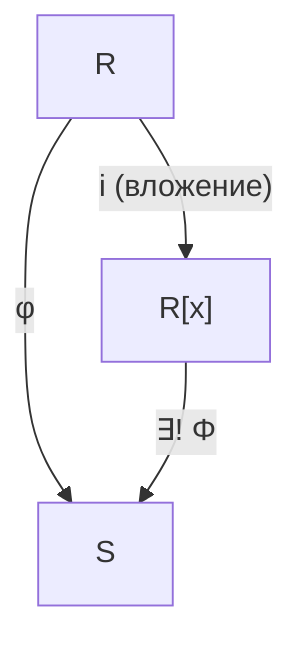

# Лекция: Характеристика кольца. Корни многочленов и поле комплексных чисел

### Содержание
1. [Характеристика кольца](#1-характеристика-кольца)
2. [Универсальное свойство кольца многочленов](#2-универсальное-свойство-кольца-многочленов)
3. [Корни многочленов и теорема Безу](#3-корни-многочленов-и-теорема-безу)
4. [Многочлены и полиномиальные функции. Теорема Вильсона](#4-многочлены-и-полиномиальные-функции-теорема-вильсона)
5. [Существование корня неприводимого многочлена. Поле $\mathbb{C}$](#5-существование-корня-неприводимого-многочлена-поле-mathbbc)
6. [Алгебраическая и тригонометрическая формы комплексных чисел](#6-алгебраическая-и-тригонометрическая-формы-комплексных-чисел)
7. [Извлечение корней и корни из единицы](#7-извлечение-корней-и-корни-из-единицы)

---

## 1. Характеристика кольца

Пусть $R$ — ассоциативное кольцо с единицей $1_R$. Тогда существует единственный гомоморфизм колец:
$$f \colon \mathbb{Z} \to R,$$
определяемый условием сохранения единицы:
$$f(1) = 1_R \implies f(n) = n \cdot 1_R = \underbrace{1_R + \dots + 1_R}_{n \text{ раз}} \quad (\forall n \in \mathbb{Z}).$$

Поскольку $\mathbb{Z}$ — кольцо главных идеалов, ядро этого гомоморфизма имеет вид:
$$\ker f = m\mathbb{Z}, \quad m \in \mathbb{Z}_{\ge 0}.$$

> **Определение 1 (Характеристика кольца)**:
> Характеристикой кольца $R$ (обозначается $\operatorname{char}(R)$) называется неотрицательное целое число $m \in \mathbb{Z}_{\ge 0}$, порождающее ядро канонического гомоморфизма $f \colon \mathbb{Z} \to R$:
> $$\operatorname{char}(R) := m \iff \ker f = m\mathbb{Z}.$$
> Эквивалентно: $\operatorname{char}(R)$ — это наименьшее натуральное число $m > 0$ такое, что:
> $$\underbrace{1_R + 1_R + \dots + 1_R}_{m \text{ раз}} = 0_R,$$
> либо $0$, если такого натурального числа не существует.

**Примеры:**
- $\operatorname{char}(\mathbb{Z}) = 0$, $\operatorname{char}(\mathbb{Q}) = 0$, $\operatorname{char}(\mathbb{R}) = 0$.
- $\operatorname{char}(\mathbb{Z} / m\mathbb{Z}) = m$.

> ⚠️ **Замечание**:
> Если $R = K$ — поле (или область целостности), то $\operatorname{char}(K)$ — либо $0$, либо простое число $p$.

**Доказательство:**  
Предположим противное: пусть $\operatorname{char}(K) = m > 0$ — составное число. Тогда найдутся такие целые $t, s$, что:
$$m = t \cdot s, \quad 1 < t, s < m.$$
Образ произведения при гомоморфизме $f$ равен:
$$f(m) = f(t \cdot s) = f(t) \cdot f(s) = 0_K.$$
Поскольку $K$ — поле, в нем отсутствуют делители нуля, следовательно:
$$f(t) = 0_K \quad \text{или} \quad f(s) = 0_K.$$
Однако $t, s < m$, что противоречит минимальности выбора $m = \operatorname{char}(K)$. Противоречие. $\blacksquare$

---

## 2. Универсальное свойство кольца многочленов

> **Теорема 1 (Универсальное свойство кольца многочленов)**:
> Пусть $\varphi \colon R \to S$ — гомоморфизм коммутативных колец, и зафиксирован элемент $\lambda \in S$. Тогда существует единственный гомоморфизм колец $\Phi \colon R[x] \to S$, продолжающий $\varphi$ и переводящий переменную $x$ в $\lambda$:
> $$\Phi|_R = \varphi, \quad \Phi(x) = \lambda.$$



**Доказательство:**  
Любой многочлен $P(x) \in R[x]$ однозначно представим в виде $P(x) = \sum_{k=0}^n a_k x^k$, где $a_k \in R$. В силу аксиом гомоморфизма колец:
$$\Phi\left(\sum_{k=0}^n a_k x^k\right) = \sum_{k=0}^n \Phi(a_k) \cdot (\Phi(x))^k = \sum_{k=0}^n \varphi(a_k)\lambda^k.$$
Заданное отображение корректно определено, единственно и сохраняет операции сложения и умножения. $\blacksquare$

---

## 3. Корни многочленов и теорема Безу

> **Определение 2 (Корень многочлена)**:
> Пусть $R$ — коммутативное кольцо с единицей, $f \in R[x]$. Элемент $a \in R$ называется *корнем* многочлена $f$, если:
> $$f(a) = 0.$$

> **Лемма 1 (Теорема Безу)**:
> Пусть $R$ — коммутативное кольцо с единицей, $f \in R[x]$, $a \in R$. Тогда:
> $$a \text{ — корень } f \iff (x - a) \mid f(x) \text{ в } R[x].$$

**Доказательство:**  
Разделим многочлен $f(x)$ на унитарный многочлен первой степени $(x - a)$ с остатком:
$$f(x) = (x - a) q(x) + r(x), \quad \deg(r) < \deg(x - a) = 1.$$
Отсюда $\deg(r) \le 0$, то есть остаток $r(x) = c \in R$ — константа. Подставив значение $x = a$:
$$f(a) = (a - a) q(a) + r(a) = r(a) = c.$$
Следовательно, $f(a) = 0 \iff r(x) = 0 \iff (x - a) \mid f(x)$. $\blacksquare$

> **Следствие 1 (О числе корней в области целостности)**:
> Пусть $R$ — область целостности, и $0 \ne f \in R[x]$. Тогда $f$ имеет не более чем $\deg(f)$ различных корней в $R$.

**Доказательство:**  
Пусть $a_1, \dots, a_k \in R$ — различные корни многочлена $f(x)$. Индукцией по $k$ получаем:
$$f(x) = (x - a_1)(x - a_2)\dots(x - a_k) h(x).$$
Так как $R$ — область целостности, степень произведения многочленов равна сумме степеней сомножителей:
$$\deg(f) = k + \deg(h) \ge k.$$
Следовательно, число различных корней $k \le \deg(f)$. $\blacksquare$

> **Определение 3 (Кратность корня)**:
> Пусть $R$ — область целостности, $f \in R[x]$, $a \in R$. Элемент $a$ называется *корнем кратности* $s \in \mathbb{N}$, если:
> $$(x - a)^s \mid f(x), \quad \text{но} \quad (x - a)^{s+1} \nmid f(x).$$
>
> В частности, любой ненулевой многочлен $f \in R[x]$ имеет не более $\deg(f)$ корней с учётом их кратностей.

---

## 4. Многочлены и полиномиальные функции. Теорема Вильсона

> ⚠️ **Важное различие**:
> Многочлен $f(x) \in R[x]$ как формальное алгебраическое выражение и соответствующая ему полиномиальная функция $\hat{f} \colon R \to R$, задаваемая формулой $a \mapsto f(a)$, — это разные математические объекты.

Равенство функций $f(a) = g(a)$ для всех $a \in R$ **не влечет** равенство многочленов $f(x) = g(x)$ в $R[x]$.

**Контрпример:**  
Рассмотрим многочлен $f(x) = x^p - x \in (\mathbb{Z}/p\mathbb{Z})[x]$. Согласно малой теореме Ферма, для любого $a \in \mathbb{Z}/p\mathbb{Z}$ выполнено $a^p - a = 0$. Соответствующая функция тождественно равна нулю на $\mathbb{Z}/p\mathbb{Z}$, однако сам многочлен $x^p - x$ ненулевой ($\deg(f) = p \ge 2$).

> **Лемма 2 (О совпадении многочленов)**:
> Пусть $K$ — поле, $f, g \in K[x]$, причем $\deg(f), \deg(g) \le n$. Если существует хотя бы $n + 1$ различных элементов $a_1, \dots, a_{n+1} \in K$ таких, что:
> $$f(a_i) = g(a_i) \quad \forall i = 1, \dots, n + 1,$$
> то $f(x) = g(x)$ в $K[x]$.

**Доказательство:**  
Рассмотрим многочлен $h(x) := f(x) - g(x)$. Ясно, что $\deg(h) \le n$. По условию, $h(a_i) = 0$ для $n+1$ различных точек. Поскольку в поле число корней ненулевого многочлена не превосходит его степени, многочлен $h$ обязан быть нулевым: $h(x) \equiv 0 \implies f(x) = g(x)$. $\blacksquare$

> **Лемма 3 (Факторизация по корням)**:
> Пусть $K$ — поле, $f \in K[x]$, $\deg(f) = n$, и пусть $x_1, \dots, x_n \in K$ — все его корни (с учетом кратностей). Тогда:
> $$f(x) = c \prod_{i=1}^n (x - x_i),$$
> где $c \in K \setminus \{0\}$ — старший коэффициент многочлена $f$.

**Доказательство:**  
По теореме Безу $f(x)$ делится на $\prod_{i=1}^n (x - x_i)$. Поскольку:
$$\deg\left(\prod_{i=1}^n (x - x_i)\right) = n = \deg(f),$$
частное от деления есть константа $c \in K$. Приравнивая старшие коэффициенты обеих частей, получаем, что $c$ совпадает со старшим коэффициентом $f(x)$. $\blacksquare$

### Пример: Доказательство теоремы Вильсона

> **Теорема 2 (Теорема Вильсона)**:
> Натуральное число $p > 1$ является простым тогда и только тогда, когда:
> $$(p - 1)! \equiv -1 \pmod p.$$

**Доказательство:**  
1. **Необходимость ($\implies$):**  
   Пусть $p$ — простое число. Рассмотрим многочлены над полем $\mathbb{Z}/p\mathbb{Z}$:
   $$f(x) = x^{p-1} - 1, \quad g(x) = (x - 1)(x - 2)\dots(x - (p - 1)).$$
   Каждый ненулевой элемент $a \in (\mathbb{Z}/p\mathbb{Z})^*$ является корнем $f(x)$ в силу малой теоремы Ферма ($a^{p-1} \equiv 1 \pmod p$). Многочлен $g(x)$ по построению имеет те же корни $1, 2, \dots, p - 1$. Оба многочлена унитарные и имеют степень $p - 1$. По лемме 2 они тождественно совпадают в $(\mathbb{Z}/p\mathbb{Z})[x]$:
   $$x^{p-1} - 1 = (x - 1)(x - 2)\dots(x - (p - 1)).$$
   Приравняем свободные члены многочленов:
   - Слева свободный член равен $-1$.
   - Справа свободный член равен $(-1)^{p-1} \cdot (p - 1)!$.
   
   При $p = 2$: $(2 - 1)! = 1 \equiv -1 \pmod 2$.  
   При нечетном $p > 2$: показатель $p - 1$ четен, следовательно, $(-1)^{p-1} = 1$.  
   В обоих случаях получаем:
   $$-1 \equiv (p - 1)! \pmod p.$$

2. **Достаточность ($\impliedby$):**  
   Пусть $p$ — составное число. Тогда существует делитель $a$ такой, что $1 < a < p$. Следовательно, $a$ входит как сомножитель в факториал $(p - 1)!$, то есть $(p - 1)! \equiv 0 \pmod a$. Если бы выполнялось $(p - 1)! \equiv -1 \pmod p$, то по модулю $a$ имели бы $0 \equiv -1 \pmod a$, что невозможно при $a > 1$. $\blacksquare$

---

## 5. Существование корня неприводимого многочлена. Поле $\mathbb{C}$

> **Теорема 3 (Кронекер)**:
> Пусть $K$ — поле, $f(x) \in K[x]$ — неприводимый над $K$ многочлен. Тогда существует расширение $L \supset K$, в котором $f(x)$ имеет корень. В качестве такого поля можно взять факторкольцо:
> $$L = K[x] / (f(x)).$$

**Доказательство:**  
1. Так как $K[x]$ — кольцо главных идеалов, а $f(x)$ неприводим, главный идеал $(f(x))$ является максимальным. Следовательно, факторкольцо $L = K[x]/(f(x))$ является полем.
2. Рассмотрим канонический факторизационный гомоморфизм:
   $$\pi \colon K[x] \to K[x]/(f(x)), \quad P(x) \mapsto \overline{P(x)} = P(x) + (f(x)).$$
   Положим $\lambda := \pi(x) = \bar{x} \in L$. Так как $\pi$ — гомоморфизм:
   $$f(\lambda) = f(\pi(x)) = \pi(f(x)) = \overline{f(x)} = 0_L.$$
   Таким образом, элемент $\lambda \in L$ является искомым корнем многочлена $f$. $\blacksquare$

### Поле комплексных чисел $\mathbb{C}$

Многочлен $x^2 + 1 \in \mathbb{R}[x]$ не имеет вещественных корней и имеет степень $2$, следовательно, неприводим над $\mathbb{R}$.

> **Определение 4 (Поле комплексных чисел)**:
> Полем комплексных чисел называется факторкольцо:
> $$\mathbb{C} := \mathbb{R}[x] / (x^2 + 1).$$
> Обозначим через $i := \pi(x) = \bar{x}$ смежный класс переменной $x$.

По определению:
$$i^2 + 1 = 0 \iff i^2 = -1.$$
Каждый многочлен $P(x) \in \mathbb{R}[x]$ при делении на $x^2 + 1$ дает остаток вида $a + bx$, поэтому каждый элемент $z \in \mathbb{C}$ однозначно представляется в виде:
$$z = a + bi, \quad a, b \in \mathbb{R}.$$

- $a = \operatorname{Re}(z)$ — вещественная часть (*real part*);
- $b = \operatorname{Im}(z)$ — мнимая часть (*imaginary part*).

Операции в $\mathbb{C}$:
$$(a + bi) + (c + di) = (a + c) + (b + d)i,$$
$$(a + bi)(c + di) = (ac - bd) + (ad + bc)i.$$

---

## 6. Алгебраическая и тригонометрическая формы комплексных чисел

> **Лемма 4 (Об автоморфизмах поля $\mathbb{C}$ над $\mathbb{R}$)**:
> Существует единственный нетождественный автоморфизм $f \colon \mathbb{C} \to \mathbb{C}$, сохраняющий поле вещественных чисел точечно ($f|_{\mathbb{R}} = \operatorname{id}_{\mathbb{R}}$). Этот автоморфизм является операцией комплексного сопряжения:
> $$z = a + bi \mapsto \bar{z} := a - bi.$$

**Доказательство:**  
Пусть $f \colon \mathbb{C} \to \mathbb{C}$ — автоморфизм, для которого $f(r) = r$ при всех $r \in \mathbb{R}$. Тогда:
$$f(a + bi) = f(a) + f(b)f(i) = a + b f(i).$$
Значение $f(i)$ полностью задает автоморфизм. При этом:
$$(f(i))^2 = f(i^2) = f(-1) = -1 \implies f(i) = \pm i.$$
- Если $f(i) = i$, получаем тождественный автоморфизм: $f = \operatorname{id}_{\mathbb{C}}$.
- Если $f(i) = -i$, получаем нетождественный автоморфизм: $f(a + bi) = a - bi = \bar{z}$. $\blacksquare$

> **Определение 5 (Модуль комплексного числа)**:
> Модулем числа $z = a + bi \in \mathbb{C}$ называется неотрицательное вещественное число:
> $$|z| := \sqrt{z \bar{z}} = \sqrt{a^2 + b^2}.$$

Если $z \ne 0$, обратный элемент вычисляется по формуле:
$$z^{-1} = \frac{\bar{z}}{|z|^2}.$$

### Тригонометрическая форма

Пусть $z \in \mathbb{C} \setminus \{0\}$. Тогда $|z| > 0$, а нормированное число лежит на единичной окружности:
$$\frac{z}{|z|} \in S^1 \subset \mathbb{C} \implies \frac{z}{|z|} = \cos\varphi + i\sin\varphi.$$

> **Определение 6 (Тригонометрическая форма и аргумент)**:
> Запись ненулевого комплексного числа в виде:
> $$z = |z|(\cos\varphi + i\sin\varphi)$$
> называется *тригонометрической формой* числа $z$. Число $\varphi \in [0, 2\pi)$ называется *аргументом* $z$ ($\varphi = \operatorname{arg}(z)$).

> **Свойства модуля и аргумента**:
> Для любых $z, w \in \mathbb{C} \setminus \{0\}$:
> 1. $|z \cdot w| = |z| \cdot |w|$;
> 2. $\operatorname{arg}(z \cdot w) \equiv \operatorname{arg}(z) + \operatorname{arg}(w) \pmod{2\pi}$;
> 3. $|z^{-1}| = |z|^{-1}, \quad \operatorname{arg}(z^{-1}) \equiv -\operatorname{arg}(z) \pmod{2\pi}$.

**Доказательство:**  
1. $|zw| = \sqrt{zw \cdot \overline{zw}} = \sqrt{z\bar{z} \cdot w\bar{w}} = \sqrt{|z|^2 |w|^2} = |z||w|$.
2. Перемножим тригонометрические представления:
   $$(\cos\varphi + i\sin\varphi)(\cos\psi + i\sin\psi) = (\cos\varphi\cos\psi - \sin\varphi\sin\psi) + i(\cos\varphi\sin\psi + \sin\varphi\cos\psi).$$
   Используя тригонометрические формулы сложения углов:
   $$= \cos(\varphi + \psi) + i\sin(\varphi + \psi). \quad \blacksquare$$

> **Следствие 2 (Формула Муавра)**:
> Для любого $n \in \mathbb{Z}$ и $z = |z|(\cos\varphi + i\sin\varphi)$:
> $$z^n = |z|^n \bigl(\cos(n\varphi) + i\sin(n\varphi)\bigr).$$

---

## 7. Извлечение корней и корни из единицы

Поставим задачу: для заданного $w \in \mathbb{C}$ и натурального $n \in \mathbb{N}$ найти все решения уравнения:
$$z^n = w.$$

Если $w = 0$, существует единственное решение $z = 0$. Пусть $w \ne 0$, и запишем его в тригонометрической форме $w = |w|(\cos\varphi + i\sin\varphi)$. Искомое число представим как $z = |z|(\cos\psi + i\sin\psi)$. По формуле Муавра:
$$z^n = w \iff \begin{cases} |z|^n = |w|, \\ n\psi \equiv \varphi \pmod{2\pi}. \end{cases}$$
Отсюда $|z| = \sqrt[n]{|w|}$, а для аргументов:
$$\psi_k = \frac{\varphi + 2\pi k}{n}, \quad k \in \mathbb{Z}.$$

> **Утверждение 1**:
> Для любого $w \in \mathbb{C} \setminus \{0\}$ уравнение $z^n = w$ имеет ровно $n$ различных комплексных корней, задаваемых значениями $k \in \{0, 1, \dots, n - 1\}$:
> $$z_k = \sqrt[n]{|w|} \left(\cos\left(\frac{\varphi + 2\pi k}{n}\right) + i\sin\left(\frac{\varphi + 2\pi k}{n}\right)\right).$$

**Доказательство:**  
Покажем, что корни $z_k$ и $z_l$ совпадают тогда и только тогда, когда $k \equiv l \pmod n$:
$$\frac{\varphi + 2\pi k}{n} - \frac{\varphi + 2\pi l}{n} = 2\pi t \quad (t \in \mathbb{Z}) \iff \frac{2\pi(k - l)}{n} = 2\pi t \iff k - l = n t.$$
Следовательно, среди значений $k = 0, 1, \dots, n-1$ все полученные числа попарно различны. $\blacksquare$

### Корни из единицы

> **Определение 7 (Корни из единицы)**:
> Комплексное число $\zeta \in \mathbb{C}$ называется *корнем $n$-й степени из единицы*, если:
> $$\zeta^n = 1.$$

> **Лемма 5**:
> Существует ровно $n$ корней $n$-й степени из единицы. Все они образуют циклическую подгруппу мультипликативной группы $\mathbb{C}^*$, порожденную элементом $\varepsilon$:
> $$\mu_n = \{1, \varepsilon, \varepsilon^2, \dots, \varepsilon^{n-1}\}, \quad \text{где } \varepsilon = \cos\left(\frac{2\pi}{n}\right) + i\sin\left(\frac{2\pi}{n}\right).$$
> Группа $(\mu_n, \cdot)$ изоморфна аддитивной группе вычетов $(\mathbb{Z}/n\mathbb{Z}, +)$.

**Геометрическая интерпретация:**  
Точки $\mu_n$ на комплексной плоскости являются вершинами правильного $n$-угольника, вписанного в единичную окружность с центром в нуле, причем одна из вершин находится в точке $1 + 0i$.

```
           Im
           ^
           |     ε (k=1)
           |    *
           |   / \
           |  /   \
 - - - - - + * - - * - - - > Re
    (k=2)  |  \   /   1 (k=0)
    ε^2    |   \ /
           |    *
           |     (n=3: правильный треугольник)
```

Обратный элемент к $\varepsilon^k$ находится как:
$$(\varepsilon^k)^{-1} = \varepsilon^{n-k}.$$

> **Определение 8 (Первообразный корень)**:
> Корень $n$-й степени из единицы $\tilde{\varepsilon}$ называется *первообразным* (*примитивным*), если его мультипликативный порядок в группе $\mathbb{C}^*$ в точности равен $n$:
> $$\operatorname{ord}(\tilde{\varepsilon}) = n \iff \langle \tilde{\varepsilon} \rangle = \mu_n.$$
> Иными словами, $\tilde{\varepsilon}$ является образующим элементом циклической группы $\mu_n$.

> **Утверждение 2 (Число первообразных корней)**:
> Элемент $\varepsilon^k = \cos\left(\frac{2\pi k}{n}\right) + i\sin\left(\frac{2\pi k}{n}\right)$ является первообразным корнем тогда и только тогда, когда $\gcd(k, n) = 1$.  
> Количество первообразных корней $n$-й степени из единицы равно значению функции Эйлера $\varphi(n)$.