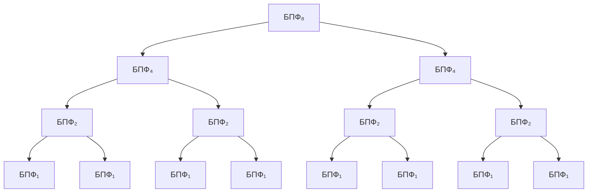

# Лекция: Быстрое преобразование Фурье, умножение многочленов и введение в конечные поля

### Основные вопросы лекции
- Дискретное преобразование Фурье (ДПФ) и лемма об обращении ДПФ.
- Алгоритм быстрого преобразования Фурье (БПФ): формула Кули — Тьюки, операция «бабочка» и оценка сложности $O(N \log N)$.
- Быстрое умножение многочленов через циклическую свёртку и БПФ.
- Конечные поля: конструкция расширения поля через факторкольцо $K[x]/(f)$, построение $\mathbb{F}_4$, существование поля разложения и критерий отсутствия кратных корней (сепарабельность).

---

## 1. Дискретное преобразование Фурье (напоминание)

> **Определение (Дискретное преобразование Фурье, ДПФ):** Пусть $K$ — поле, $\omega \in K$ — первообразный корень из $1$ степени $N$. *Дискретным преобразованием Фурье* называется линейное отображение $F_\omega \colon K^N \to K^N$, задаваемое формулой:
> $$a = (a_0, \dots, a_{N-1}) \mapsto \bigl(F_\omega(a)_0, \dots, F_\omega(a)_{N-1}\bigr),$$
> где
> $$F_\omega(a)_j = \sum_{k=0}^{N-1} a_k \omega^{jk}, \qquad j \in \{0, \dots, N-1\}.$$

> **Лемма (Об обратном ДПФ):** Обратное к $F_\omega$ преобразование выражается формулой:
> $$F_\omega^{-1} = \frac{1}{N} F_{\omega^{-1}},$$
> то есть коэффициенты вектора $a$ восстанавливаются как
> $$a_k = \frac{1}{N} \sum_{j=0}^{N-1} F_\omega(a)_j \omega^{-jk}.$$

**Доказательство:**
Вычислим сумму в правой части, подставив определение $F_\omega(a)_j$:
$$\begin{aligned}
\frac{1}{N} \sum_{j=0}^{N-1} F_\omega(a)_j \omega^{-jk}
&= \frac{1}{N} \sum_{j=0}^{N-1} \left( \sum_{t=0}^{N-1} a_t \omega^{jt} \right) \omega^{-jk} \\
&= \frac{1}{N} \sum_{t=0}^{N-1} a_t \sum_{j=0}^{N-1} \omega^{j(t-k)}.
\end{aligned}$$
Так как $0 \le t, k < N$ и $\omega$ — первообразный корень из $1$ степени $N$, внутренняя сумма равна:
$$\sum_{j=0}^{N-1} \omega^{j(t-k)} =
\begin{cases}
N, & \text{если } t = k, \\
0, & \text{иначе.}
\end{cases}$$
Следовательно, в сумме по $t$ остаётся только слагаемое при $t = k$, что даёт $\frac{1}{N} \cdot a_k \cdot N = a_k$. $\blacksquare$

---

## 2. Быстрое преобразование Фурье (БПФ)

Пусть $N = 2^s$, характеристика поля $\operatorname{char}(K) \neq 2$ (что обеспечивает существование $\frac{1}{N}$ в $K$) и пусть $\omega \in K$ — первообразный корень из $1$ степени $N$. Поскольку $\omega$ первообразный, $\omega^{N/2} \neq 1$, но
$$0 = \omega^N - 1 = \left(\omega^{N/2} - 1\right)\left(\omega^{N/2} + 1\right) \implies \omega^{N/2} = -1.$$

Рассмотрим многочлен $f(x) = a_0 + a_1 x + \dots + a_{N-1} x^{N-1} \in K[x]$. Разобьём его на чётную и нечётную части:
$$f(x) = r(x^2) + x s(x^2),$$
где
$$r(y) = a_0 + a_2 y + \dots + a_{N-2} y^{\frac{N}{2} - 1}, \qquad s(y) = a_1 + a_3 y + \dots + a_{N-1} y^{\frac{N}{2} - 1}.$$
При этом $\deg r, \deg s < \frac{N}{2}$, а элемент $\omega^2$ является первообразным корнем из $1$ степени $\frac{N}{2}$.

> **Утверждение (Формула Кули — Тьюки):** Обозначим через $U$ и $V$ дискретные преобразования Фурье длины $\frac{N}{2}$ от чётных и нечётных коэффициентов соответственно:
> $$U = F_{\omega^2}\bigl((a_0, a_2, \dots, a_{N-2})\bigr), \qquad V = F_{\omega^2}\bigl((a_1, a_3, \dots, a_{N-1})\bigr).$$
> Тогда для всех $0 \le j < \frac{N}{2}$ выполняются равенства:
> $$F_\omega(a)_j = U_j + \omega^j V_j, \qquad F_\omega(a)_{j + \frac{N}{2}} = U_j - \omega^j V_j.$$

**Доказательство:**
Подставим $x = \omega^j$ в разложение $f(x) = r(x^2) + x s(x^2)$:
$$F_\omega(a)_j = f(\omega^j) = \underbrace{r(\omega^{2j})}_{U_j} + \omega^j \underbrace{s(\omega^{2j})}_{V_j} = U_j + \omega^j V_j.$$
Теперь рассмотрим значение в точке $\omega^{j + \frac{N}{2}}$. Так как $\omega^{\frac{N}{2}} = -1$, имеем:
$$\omega^{j + \frac{N}{2}} = \omega^j \cdot \omega^{\frac{N}{2}} = -\omega^j, \qquad \left(\omega^{j + \frac{N}{2}}\right)^2 = \omega^{2j + N} = \omega^{2j}.$$
Подставляя $x = \omega^{j + \frac{N}{2}}$ в $f(x)$, получаем:
$$F_\omega(a)_{j + \frac{N}{2}} = f\left(\omega^{j + \frac{N}{2}}\right) = r(\omega^{2j}) - \omega^j s(\omega^{2j}) = U_j - \omega^j V_j. \quad \blacksquare$$

> 💡 **Идея (Операция «бабочка»):** Пересчёт пары значений $(U_j, V_j)$ в пару $\bigl(F_\omega(a)_j, F_\omega(a)_{j+N/2}\bigr)$ сводится к элементарному преобразованию вида
> $$(u, v) \mapsto (u + \alpha v, \, u - \alpha v),$$
> где $\alpha = \omega^j$. Для одного $j$ требуется $1$ умножение на $\omega^j$ (при предварительном вычислении степеней $\omega^j$), $1$ сложение и $1$ вычитание — всего $3$ операции в поле $K$.

> **Следствие:** БПФ вычисляет ДПФ за $O(N \log N)$ операций в поле $K$.

**Доказательство:**
Пусть $T(N)$ — число операций в поле $K$, затрачиваемых алгоритмом БПФ на входе длины $N$. На каждом шаге задача сводится к двум подзадачам размера $\frac{N}{2}$ и выполнению $\frac{N}{2}$ операций «бабочка» (по $3$ операции на каждую, итого $\frac{3}{2} N$ операций). Тогда для $t = \log_2 N$ шагов рекурсии с учётом базы $T(1) = 0$ получаем:
$$\begin{aligned}
T(N) &\le 2 \cdot T\left(\frac{N}{2}\right) + \frac{3}{2} N \\
&\le 2 \left(2 \cdot T\left(\frac{N}{4}\right) + \frac{3}{2} \cdot \frac{N}{2}\right) + \frac{3}{2} N = 4 \cdot T\left(\frac{N}{4}\right) + 2 \cdot \frac{3}{2} N \\
&\le \dots \le 2^t \cdot T\left(\frac{N}{2^t}\right) + t \cdot \frac{3}{2} N \\
&= N \cdot T(1) + \frac{3}{2} N \log_2 N = \frac{3}{2} N \log_2 N,
\end{aligned}$$
то есть $T(N) = O(N \log N)$. $\blacksquare$

Структуру рекурсивных вызовов алгоритма для $N = 8$ иллюстрирует следующее дерево:

---

## 3. Быстрое умножение многочленов

Отождествим векторы из $K^N$ с элементами факторкольца многочленов по модулю $x^N - 1$. Преобразование $F_\omega$ задаёт изоморфизм алгебр:
$$K[x] / (x^N - 1) \xrightarrow[F_\omega]{\cong} K^N.$$

Пусть $a, b \in K[x] / (x^N - 1)$. Определим их произведение в этом кольце $c = a * b$ — **циклическую свёртку**:
$$c_r = \sum_{k + j \equiv r \pmod{N}} a_k b_j,$$
что соответствует правилу умножения мономов в факторкольце: $x^k \cdot x^j = x^{(k+j) \bmod N}$.

> **Следствие:** ДПФ переводит циклическую свёртку в покомпонентное умножение векторов в $K^N$:
> $$F_\omega(a * b) = F_\omega(a) \odot F_\omega(b),$$
> где $\odot$ обозначает покомпонентное умножение: $(u \odot v)_i = u_i \cdot v_i$.

> **Предложение:** Пусть $f, g \in K[x]$, $\deg f, \deg g < d$ и $N = 2^s \ge 2d - 1$. Тогда произведение многочленов $f \cdot g$ вычисляется за $O(N \log N)$ операций в поле $K$.

**Доказательство:**
Дополним списки коэффициентов многочленов $f$ и $g$ нулями до векторов $a, b \in K^N$ длины $N$. Заметим, что значения ДПФ совпадают со значениями многочленов в степенях $\omega$:
$$F_\omega(a)_i = f(\omega^i), \qquad F_\omega(b)_i = g(\omega^i).$$
Вычислим $F_\omega(a)$ и $F_\omega(b)$ с помощью БПФ за $O(N \log N)$ операций, а затем перемножим их покомпонентно за $O(N)$ операций:
$$c_i = F_\omega(a)_i \cdot F_\omega(b)_i = \bigl(F_\omega(a * b)\bigr)_i.$$
Таким образом, применяя обратное БПФ (лемма об обратном ДПФ), восстанавливаем циклическую свёртку за $O(N \log N)$ операций:
$$a * b = F_\omega^{-1}\bigl(F_\omega(a) \odot F_\omega(b)\bigr) = \frac{1}{N} F_{\omega^{-1}}\bigl(F_\omega(a) \odot F_\omega(b)\bigr).$$
Поскольку $\deg(f \cdot g) \le (d - 1) + (d - 1) = 2d - 2 < N$, приведение по модулю $x^N - 1$ не меняет коэффициентов произведения $f \cdot g$, то есть циклическая свёртка $a * b$ в точности совпадает с вектором коэффициентов многочлена $f \cdot g$. Итоговая сложность составляет $O(N \log N)$. $\blacksquare$

---

## 4. Конечные поля

Напомним конструкцию присоединения корня неприводимого многочлена <!-- TODO: вводная фраза в верхней части страницы 3 неразборчива -->:

Если $K$ — поле и $f \in K[x]$ — неприводимый многочлен, то факторкольцо
$$L = K[x] / (f)$$
является полем. В поле $L$ у многочлена $f$ есть корень — это класс смежности $[x] = x \bmod f$.

В частности, для любого простого числа $p$ кольцо вычетов $\mathbb{Z}/p\mathbb{Z}$ является простым конечным полем, обозначаемым $\mathbb{F}_p$.

**Пример** <!-- TODO: пояснение в скобках после слова "Пример" неразборчиво на странице 4 -->**:**
Рассмотрим поле $\mathbb{F}_2$ и многочлен $f(x) = x^2 + x + 1 \in \mathbb{F}_2[x]$. Он неприводим над $\mathbb{F}_2$ (так как имеет степень $2$ и не имеет корней в $\mathbb{F}_2$: $f(0) = 1$, $f(1) = 1$). Построим поле из $4$ элементов:
$$\mathbb{F}_4 = \mathbb{F}_2[x] / (x^2 + x + 1),$$
рассматривая естественный гомоморфизм факторизации $\pi \colon \mathbb{F}_2[x] \to \mathbb{F}_4$, переводящий $x \mapsto \omega$, где $\omega$ — корень многочлена $x^2 + x + 1$ в $\mathbb{F}_4$. Тогда:
$$\mathbb{F}_4 = \bigl\{ a + b\omega \;\big|\; a, b \in \mathbb{F}_2, \; \omega^2 + \omega + 1 = 0 \bigr\} = \{ 0, \, 1, \, \omega, \, \omega + 1 \}.$$

> **Следствие (О существовании поля разложения):** Пусть $f(x) \in K[x]$ — неприводимый <!-- TODO: слово после "неприводимый" неразборчиво на странице 4 --> многочлен. Тогда существует расширение полей $F \supset K$ такое, что $f(x)$ раскладывается на линейные множители над $F$.

**Доказательство:**
Применим индукцию по $\deg f$. Присоединив один корень $\alpha$ в расширении $L = K[x]/(f)$ (или взяв неприводимый делитель $f$ в общем случае), получим разложение в $L[x]$:
$$f(x) = (x - \alpha) g(x), \qquad \deg g < \deg f.$$
Повторяя этот шаг для каждого неприводимого множителя $g(x)$, строим конечную башню расширений $K \subset L \subset \dots \subset F$, в последнем из которых $f(x)$ полностью раскладывается на линейные множители. $\blacksquare$

> ⚠️ **Замечание (О кратных корнях и сепарабельности):** Пусть $f(x) \in K[x]$. Многочлен $f$ не имеет кратных корней ни в каком расширении $R \supset K$ тогда и только тогда, когда $f$ и его формальная производная $f'$ взаимно просты в $K[x]$ ($\gcd(f, f') = 1$).

**Доказательство:**
- $(\Leftarrow)$ Если $f$ и $f'$ взаимно просты, то по соотношению Безу существуют $u, v \in K[x]$ такие, что
  $$u f + v f' = 1.$$
  Если бы $\alpha$ в некотором расширении $R \supset K$ являлся кратным корнем $f$, то выполнялось бы $f(\alpha) = 0$ и $f'(\alpha) = 0$. Подставляя $x = \alpha$ в тождество Безу, получили бы $0 = 1$, что невозможно.
- $(\Rightarrow)$ Предположим обратное: $\deg\bigl(\gcd(f, f')\bigr) \ge 1$ или $f' = 0$ (тогда $\gcd(f, f') = f$, и при $\deg f \ge 1$ степень наибольшего общего делителя также $\ge 1$). Тогда у общего множителя $\gcd(f, f')$ существует корень $\alpha$ в некотором расширении $L \supset K$. Для этого $\alpha$ одновременно $f(\alpha) = 0$ и $f'(\alpha) = 0$, следовательно, $\alpha$ — кратный корень многочлена $f$ в $L$.

Такие многочлены $f$ (не имеющие кратных корней ни в каком расширении) называются *сепарабельными*. $\blacksquare$