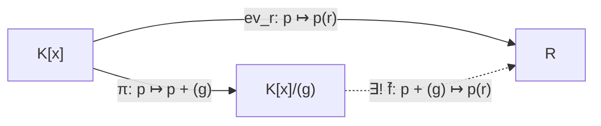
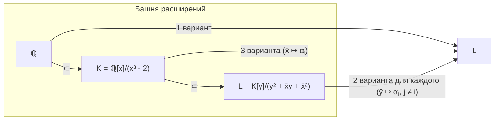

# Лекция: Гомоморфизмы колец многочленов, группы автоморфизмов полей и критерий Эйзенштейна

### Содержание лекции
- Универсальные свойства кольца многочленов $K[x]$ и факторкольца $K[x]/(g)$.
- Поле разложения многочлена $x^3 - 2$ и вычисление групп автоморфизмов расширений $\mathbb{Q}[2^{1/3}]$, $L$ и $\mathbb{Q}[\sqrt{2}, \sqrt{3}]$.
- Лемма Гаусса (сведение разложимости в $\mathbb{Q}[x]$ к разложимости в $\mathbb{Z}[x]$).
- Критерий неприводимости Эйзенштейна и его приложения.
- Круговые многочлены $\Phi_n(x)$ и неприводимость $\Phi_p(x)$.

---

## 1. Универсальные свойства $K[x]$ и $K[x]/(g)$

Пусть $K$ — поле (или коммутативное кольцо с единицей), а $R$ — коммутативная $K$-алгебра. Напомним, что гомоморфизм $K$-алгебр $f \colon K[x] \to R$ — это гомоморфизм колец, тождественный на $K$, то есть $f(\alpha) = \alpha$ для всех $\alpha \in K$.

> **Утверждение 1 (Универсальное свойство кольца многочленов):**
> Для любого элемента $r \in R$ существует единственный гомоморфизм $K$-алгебр (гомоморфизм подстановки)
> $$\operatorname{ev}_r \colon K[x] \to R, \qquad p(x) \mapsto p(r),$$
> переводящий переменную $x$ в $r$.

> **Утверждение 2 (Универсальное свойство факторкольца $K[x]/(g)$):**
> Пусть $g \in K[x]$ — фиксированный многочлен, и $\bar{x} = x + (g) \in K[x]/(g)$. Гомоморфизмы $K$-алгебр $f \colon K[x]/(g) \to R$ находятся в биективном соответствии с корнями многочлена $g$ в $R$:
> $$\forall r \in R \text{ такого, что } g(r) = 0, \quad \exists!\; \bar{f} \colon K[x]/(g) \to R, \quad \bar{f}\bigl(p + (g)\bigr) = p(r).$$

**Доказательство:**

Если $f \colon K[x]/(g) \to R$ — гомоморфизм $K$-алгебр и $r = f(\bar{x})$, то в факторкольце $K[x]/(g)$ выполняется $g(\bar{x}) = \overline{g(x)} = 0$, откуда:
$$0 = f\bigl(g(\bar{x})\bigr) = g\bigl(f(\bar{x})\bigr) = g(r).$$
Обратно, если $g(r) = 0$, то $(g) \subseteq \ker(\operatorname{ev}_r)$, и по универсальному свойству факторкольца (теореме о гомоморфизме) отображение $\operatorname{ev}_r$ единственным образом пропускается через каноническую проекцию $\pi \colon K[x] \to K[x]/(g)$:

Тем самым $\bar{f}(\bar{x}) = r$ задаёт искомый единственный гомоморфизм $K$-алгебр. $\blacksquare$

**Пример:**

Рассмотрим вещественное поле
$$K = \mathbb{Q}\!\left[2^{1/3}\right] = \left\{ a + b \cdot 2^{1/3} + c \cdot 2^{2/3} \;\middle|\; a, b, c \in \mathbb{Q} \right\} \cong \mathbb{Q}[x]/(x^3 - 2).$$
Вычислим группу автоморфизмов $\operatorname{Aut}(K)$. Любой автоморфизм поля $K$ автоматически тождественен на простом подполе $\mathbb{Q}$, то есть является гомоморфизмом $\mathbb{Q}$-алгебр $\mathbb{Q}[x]/(x^3 - 2) \to K$. По Утверждению 2 такие гомоморфизмы взаимно однозначно соответствуют корням многочлена $x^3 - 2$ в $K$. Поскольку $K \subset \mathbb{R}$, единственным корнем уравнения $x^3 - 2 = 0$ в $K$ является $2^{1/3}$. Следовательно,
$$\operatorname{Aut}(K) = \{e\}.$$

---

## 2. Поле разложения многочлена $x^3 - 2$ и его группа автоморфизмов

Пусть $\alpha \in \mathbb{C}$ — произвольный корень уравнения $\alpha^3 = 2$, и
$$K = \mathbb{Q}[\alpha] = \left\{ a + b\alpha + c\alpha^2 \;\middle|\; a, b, c \in \mathbb{Q} \right\} \cong \mathbb{Q}[x]/(x^3 - 2),$$
где изоморфизм задаётся соответствием $a + b\alpha + c\alpha^2 \longleftrightarrow a + b\bar{x} + c\bar{x}^2$.

Разложим $x^3 - 2$ над полем $K$:
$$x^3 - 2 = (x - \alpha)(x^2 + \alpha x + \alpha^2).$$
Дискриминант квадратного сомножителя равен
$$D = \alpha^2 - 4\alpha^2 = -3\alpha^2.$$
Многочлен $x^2 + \alpha x + \alpha^2$ приводим над $K$ тогда и только тогда, когда $D$ является квадратом в $K$, что равносильно существованию элемента $\beta \in K$ такого, что $\beta^2 = -3$.

> **Утверждение 3:**
> В поле $K \cong \mathbb{Q}[x]/(x^3 - 2)$ не существует элемента $\beta \in K$, удовлетворяющего $\beta^2 = -3$. В частности, многочлен $y^2 + \alpha y + \alpha^2$ неприводим над $K$.

**Доказательство:**

Предположим противное: пусть $\beta = a + b\alpha + c\alpha^2 \in K$ ($a, b, c \in \mathbb{Q}$) и $\beta^2 = -3$. Возведём $\beta$ в квадрат, используя соотношения $\alpha^3 = 2$ и $\alpha^4 = 2\alpha$:
$$\begin{aligned}
(a + b\alpha + c\alpha^2)^2 &= a^2 + b^2\alpha^2 + c^2\alpha^4 + 2ab\alpha + 2ac\alpha^2 + 2bc\alpha^3 \\
&= (a^2 + 4bc) + 2(c^2 + ab)\alpha + (b^2 + 2ac)\alpha^2.
\end{aligned}$$
Поскольку элементы $1, \alpha, \alpha^2$ образуют базис $K$ над $\mathbb{Q}$, равенство $\beta^2 = -3$ равносильно системе уравнений:
$$\begin{cases}
a^2 + 4bc = -3, \\
c^2 + ab = 0, \\
b^2 + 2ac = 0.
\end{cases}$$
Из второго уравнения получаем $ab = -c^2$, а из третьего — $2ac = -b^2$. Умножая первое соотношение на $c$, а второе на $\frac{b}{2}$, находим:
$$abc = -c^3 = -\frac{b^3}{2} \implies b^3 = 2c^3.$$
- Если $c \neq 0$, то $\left(\frac{b}{c}\right)^3 = 2$, что невозможно в $\mathbb{Q}$.
- Следовательно, $c = 0$. Тогда из третьего уравнения $b^2 = 0$, откуда $b = 0$.
- Подставляя $b = c = 0$ в первое уравнение, получаем $a^2 = -3$, что не имеет решений в $\mathbb{Q}$.

Полученное противоречие завершает доказательство. $\blacksquare$

Поскольку многочлен $y^2 + \alpha y + \alpha^2$ неприводим над $K$, построим его поле разложения (являющееся полем разложения $x^3 - 2$ над $\mathbb{Q}$):
$$L = K[y]/(y^2 + \alpha y + \alpha^2) \cong \mathbb{Q}[x, y]/(x^3 - 2,\; y^2 + xy + x^2).$$

Пусть $\alpha_1, \alpha_2, \alpha_3 \in L$ — три различных корня многочлена $x^3 - 2$. Любой автоморфизм $\sigma \in \operatorname{Aut}(L)$ переставляет множество корней $\{\alpha_1, \alpha_2, \alpha_3\}$ и однозначно определяется своим действием на этом множестве (так как $L$ порождено корнями $x^3 - 2$ над $\mathbb{Q}$). Это задаёт инъективный гомоморфизм групп:
$$\operatorname{Aut}(L) \hookrightarrow S_3.$$

Подсчитаем число автоморфизмов $|\operatorname{Aut}(L)|$, продолжая тождественное вложение $\mathbb{Q} \hookrightarrow L$ вверх по башне полей $\mathbb{Q} \subset K \subset L$:

1. Вложение $\mathbb{Q} \hookrightarrow L$ продолжается до вложения $K = \mathbb{Q}[x]/(x^3 - 2) \hookrightarrow L$ ровно **$3$ способами**: образ $\bar{x}$ может быть равен любому из корней $\alpha_1, \alpha_2, \alpha_3$.
2. При фиксированном выборе $\bar{x} \mapsto \alpha_i$ многочлен $y^2 + \alpha_i y + \alpha_i^2$ имеет в $L$ ровно два различных корня (два оставшихся корня $x^3 - 2$). Значит, вложение $K \hookrightarrow L$ продолжается до автоморфизма $L \to L$ ровно **$2$ способами**.

Итого $|\operatorname{Aut}(L)| = 3 \cdot 2 = 6 = |S_3|$, откуда
$$\operatorname{Aut}(L) \cong S_3.$$

**Пример (биквадратичное расширение):**

Для поля
$$F = \mathbb{Q}[\sqrt{2}, \sqrt{3}] = \mathbb{Q}[\sqrt{2} + \sqrt{3}]$$
группа автоморфизмов изоморфна четверной группе Клейна:
$$\operatorname{Aut}(F) \cong V_4 \le S_4$$
(автоморфизмы независимо меняют знаки у $\sqrt{2}$ и $\sqrt{3}$, переставляя $4$ корня $\pm\sqrt{2} \pm \sqrt{3}$ минимального многочлена элемента $\sqrt{2} + \sqrt{3}$).

---

## 3. Лемма Гаусса и критерий Эйзенштейна

> **Лемма 1 (Лемма Гаусса о факторизации):**
> Пусть $f \in \mathbb{Z}[x]$. Если $f$ разлагается в произведение $f = gh$ в $\mathbb{Q}[x]$, то существуют многочлены $\tilde{\tilde{g}}, \tilde{\tilde{h}} \in \mathbb{Z}[x]$ тех же степеней ($\deg \tilde{\tilde{g}} = \deg g$, $\deg \tilde{\tilde{h}} = \deg h$) такие, что $f = \tilde{\tilde{g}}\tilde{\tilde{h}}$.

**Доказательство:**

Умножим равенство $f = gh$ на общий знаменатель коэффициентов многочленов $g$ и $h$ — некоторое натуральное число $N \in \mathbb{Z}_{>0}$ — так, чтобы получить равенство в $\mathbb{Z}[x]$:
$$N f = \tilde{g}\tilde{h}, \qquad \tilde{g}, \tilde{h} \in \mathbb{Z}[x].$$
Если $N > 1$, выберем произвольный простой делитель $p \mid N$ и рассмотрим гомоморфизм редукции коэффициентов по модулю $p$:
$$\pi \colon \mathbb{Z}[x] \to \mathbb{F}_p[x].$$
Так как $p \mid N$, в кольце $\mathbb{F}_p[x]$ выполняется:
$$0 = \pi(Nf) = \pi(\tilde{g})\pi(\tilde{h}).$$
Поскольку $\mathbb{F}_p$ — поле, кольцо многочленов $\mathbb{F}_p[x]$ является областью целостности (не имеет делителей нуля). Следовательно, $\pi(\tilde{g}) = 0$ или $\pi(\tilde{h}) = 0$, что означает делимость всех коэффициентов одного из многочленов на $p$:
$$p \mid \tilde{g} \quad \text{или} \quad p \mid \tilde{h}.$$
Разделив на $p$ число $N$ и соответствующий многочлен ($\tilde{g}$ или $\tilde{h}$), мы строго уменьшим $N$, оставаясь в кольце $\mathbb{Z}[x]$. Повторяя этот шаг для всех простых множителей числа $N$ (с учётом кратности), мы полностью сократим $N$ и получим искомое разложение:
$$f = \tilde{\tilde{g}}\tilde{\tilde{h}}, \qquad \tilde{\tilde{g}}, \tilde{\tilde{h}} \in \mathbb{Z}[x]. \qquad \blacksquare$$

> **Теорема 1 (Критерий Эйзенштейна):**
> Пусть $f(x) = a_n x^n + \dots + a_1 x + a_0 \in \mathbb{Z}[x]$. Предположим, что существует простое число $p$, для которого выполнены три условия:
> 1. $p \nmid a_n$;
> 2. $p \mid a_i$ для всех $i = 0, 1, \dots, n - 1$;
> 3. $p^2 \nmid a_0$.
>
> Тогда многочлен $f$ неприводим в $\mathbb{Q}[x]$.

**Доказательство:**

Предположим, что $f$ приводим в $\mathbb{Q}[x]$. По Лемме 1 многочлен $f$ допускает нетривиальное разложение в $\mathbb{Z}[x]$:
$$a_n x^n + \dots + a_1 x + a_0 = (b_m x^m + \dots + b_1 x + b_0)(c_k x^k + \dots + c_1 x + c_0),$$
где $b_i, c_j \in \mathbb{Z}$, $n = m + k$ и $1 \le m, k < n$.

Рассмотрим свободный член: $a_0 = b_0 c_0$. Так как $p \mid a_0$, но $p^2 \nmid a_0$, простое число $p$ делит ровно один из множителей $b_0, c_0$. Без ограничения общности будем считать, что
$$p \mid b_0, \qquad p \nmid c_0.$$

Докажем по индукции, что $p \mid b_0, b_1, \dots, b_m$:
- **База ($i = 0$):** $p \mid b_0$ уже установлено.
- **Шаг индукции:** пусть для некоторого $j \in \{1, \dots, m\}$ уже доказано, что $p \mid b_0, b_1, \dots, b_{j-1}$. Выпишем коэффициент при $x^j$ в произведении:
  $$\begin{aligned}
  a_1 &= b_1 c_0 + b_0 c_1, \\
  a_2 &= b_2 c_0 + b_1 c_1 + b_0 c_2, \\
  &\;\;\vdots \\
  a_j &= b_j c_0 + b_{j-1} c_1 + \dots + b_0 c_j.
  \end{aligned}$$
  Поскольку $j \le m < n$, по условию (2) выполняется $p \mid a_j$. Все слагаемые $b_{j-1} c_1, \dots, b_0 c_j$ делятся на $p$ по предположению индукции. Следовательно, $p \mid b_j c_0$. Так как $p$ простое и $p \nmid c_0$, отсюда следует $p \mid b_j$.

В частности, при $j = m$ получаем $p \mid b_m$. Однако старший коэффициент многочлена $f$ равен $a_n = b_m c_k$, откуда $p \mid a_n$, что противоречит условию (1). Таким образом, $f$ неприводим в $\mathbb{Q}[x]$. $\blacksquare$

**Пример 1:**

Для любого простого числа $p$ и любого $n \ge 1$ многочлен
$$f(x) = x^n - p$$
неприводим в $\mathbb{Q}[x]$ непосредственно по критерию Эйзенштейна для простого $p$ (так как $p \nmid 1$, все промежуточные коэффициенты равны $0$ и делятся на $p$, $p \mid (-p)$ и $p^2 \nmid (-p)$).

---

## 4. Круговые многочлены и неприводимость $\Phi_p(x)$

Чтобы применять критерий Эйзенштейна к более широкому классу многочленов, полезно использовать автоморфизмы кольца многочленов $\mathbb{Q}[x]$:
$$\varphi \colon \mathbb{Q}[x] \to \mathbb{Q}[x], \qquad x \mapsto ax + b \quad (a \in \mathbb{Q} \setminus \{0\},\; b \in \mathbb{Q}).$$
Поскольку $\varphi$ — автоморфизм кольца $\mathbb{Q}[x]$, многочлен $f(x)$ неприводим в $\mathbb{Q}[x]$ тогда и только тогда, когда неприводим многочлен $f(ax + b)$.

**Пример 2 (неприводимость $p$-го кругового многочлена):**

Пусть $p$ — простое число. Покажем, что многочлен
$$f(x) = x^{p-1} + x^{p-2} + \dots + x + 1$$
неприводим в $\mathbb{Q}[x]$.

Применим автоморфизм сдвига $x \mapsto x + 1$ ($a = 1, b = 1$). Заметив, что $f(x) = \frac{x^p - 1}{x - 1}$, вычислим $f(x + 1)$ с помощью бинома Ньютона:
$$\begin{aligned}
f(x + 1) &= \frac{(x + 1)^p - 1}{(x + 1) - 1} = \frac{1}{x} \left( \sum_{k=0}^{p} \binom{p}{k} x^k - 1 \right) = \sum_{k=1}^{p} \binom{p}{k} x^{k-1} \\
&= x^{p-1} + \binom{p}{p-1} x^{p-2} + \dots + \binom{p}{2} x + \binom{p}{1}.
\end{aligned}$$
Проверим условия критерия Эйзенштейна для многочлена $f(x + 1)$ и простого числа $p$:
1. Старший коэффициент равен $\binom{p}{p} = 1$, и $p \nmid 1$.
2. Для всех $k = 1, \dots, p - 1$ биномиальный коэффициент
   $$\binom{p}{k} = \frac{p!}{k!(p - k)!}$$
   делится на $p$, поскольку простое число $p$ делит числитель $p!$, но не делит знаменатель $k!(p - k)!$ (все сомножители в знаменателе строго меньше $p$).
3. Свободный член равен $\binom{p}{1} = p$, и $p^2 \nmid p$.

По критерию Эйзенштейна многочлен $f(x + 1)$ неприводим в $\mathbb{Q}[x]$. Следовательно, и исходный многочлен $f(x) = x^{p-1} + x^{p-2} + \dots + x + 1$ неприводим в $\mathbb{Q}[x]$.

> **Следствие:**
> Для простого числа $p$ факторкольцо
> $$\mathbb{Q}[x]/(x^{p-1} + \dots + x + 1) \cong \mathbb{Q}[\zeta_p]$$
> является полем степени $p - 1$ над $\mathbb{Q}$, где $\zeta_p$ — первообразный корень $p$-й степени из $1$.

> **Определение 1 (Круговой многочлен):**
> Для произвольного натурального числа $n \ge 1$ **$n$-м круговым многочленом** называется многочлен
> $$\Phi_n(x) = \prod_{\substack{\alpha \text{ — первообразный} \\ \text{корень степени } n \text{ из } 1}} (x - \alpha) \in \mathbb{Z}[x].$$

> ⚠️ **Замечание:** При простом $n = p$ все отличные от $1$ корни $p$-й степени из единицы являются первообразными, поэтому $\Phi_p(x) = x^{p-1} + x^{p-2} + \dots + x + 1$. В общем случае можно показать, что $\Phi_n(x) \in \mathbb{Z}[x]$ неприводим над $\mathbb{Q}$ для любого $n \ge 1$.